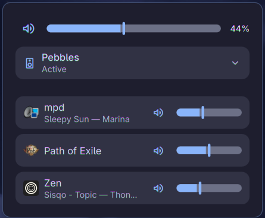

# Volume Mixer

Standalone volume mixer for [dms](https://github.com/AvengeMedia/DankMaterialShell). Control master volume, switch audio sinks, and adjust per-app playback levels from your bar.

- Streams are grouped per application, with the app's real name and icon resolved from its desktop entry.
- Groups with more than one stream expand to per-stream volume and mute controls.
- Rows show what's playing when the app exposes an MPRIS session.
- Hover an app icon to reset that app back to 100%.
- Hover the master percentage to reset the output back to 100%.

## Install

Available live in your shell via the [DMS Plugin Registry](https://danklinux.com/plugins).

## Contributing

PRs are open.
